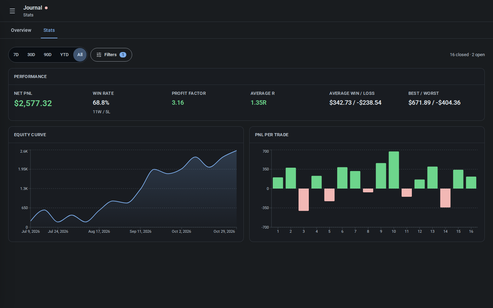
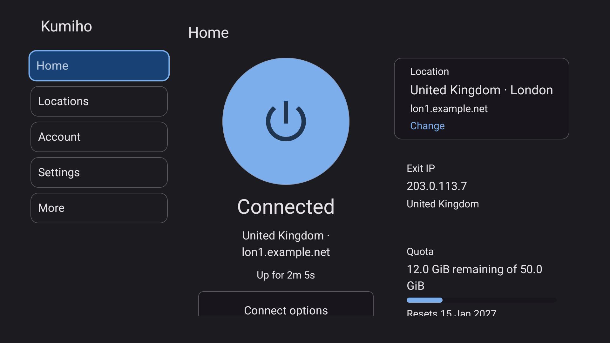
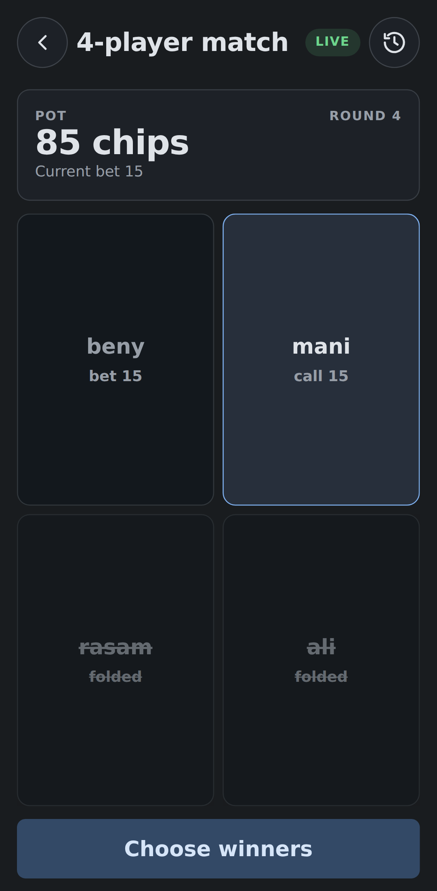
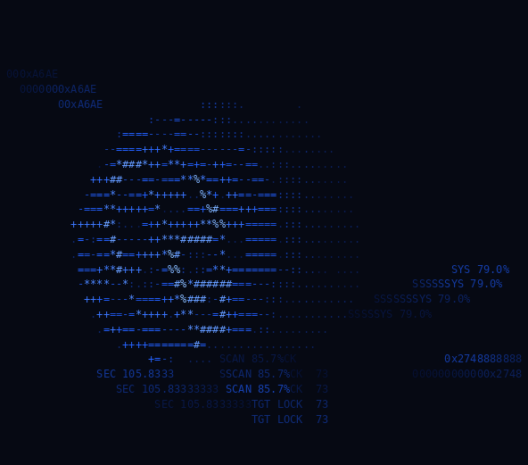

## benyamin

**just another vibe coder**

[benyaminprotonmail@proton.me](mailto:benyaminprotonmail@proton.me)

---

### I’m currently working on:
- [Dr. BM Shoes Official Website](https://drbmshoes.com): static Persian storefront for a medical footwear shop, catalog-only, orders through Bale or WhatsApp (not open source and not owned by me), plus a Telegram catalogue bot and public catalogue at [@drbmshoes](https://t.me/drbmshoes).
- [ClyTrade](https://github.com/benyamin-git/ClyTrade): a local-first trading app with a trade journal, spot portfolio tracker, price alerts and calculators, plus an installable PWA with windows and android builds. these tools don't need server side services and shouldn't be behind subscription plans, but are, so i have to vibe code them. [Github Page Sample](https://benyamin-git.github.io/ClyTrade)
- [Kumiho](https://github.com/benyamin-git/Kumiho): unofficial linux, windows, android and android tv client for the free firefox-account vpn proxy, with a daemon, TUI/CLI/GUI, TUN/Wintun, a kill switch and systemd/windows service support, similar to and inspired by [FoxyVPN](https://github.com/Vauth/FoxyVPN).

### Active side projects:
- [dailypoker.bot](https://github.com/benyamin-git/dailypoker.bot): opinionated version of poker i play with friends as a telegram bot running as a single bun process with a local sqlite database over long polling. (not normal betting rules and not real money)
- [poker.pot](https://github.com/benyamin-git/poker.pot): opinionated poker pot manager as a phone-viewport webapp with android apk and home-screen pwa support, to keep track of my friend group's poker bets to substitute a lack of chips. (not normal betting rules) [Github Page Sample](https://benyamin-git.github.io/poker.pot)
- [ORBYN](https://github.com/benyamin-git/ORBYN): simple lightweight terminal screensaver with an orb, a carrion creature and an ascii worm to prevent burn-in.
- [Inlign](https://github.com/benyamin-git/Inlign): early draft of a project similar to but not inspired by [Soulver](https://soulver.app/), with one equation per card and a Rust/WASM engine that computes and cross-checks values as you type. the card notepad, variable engine and installable PWA work; no tagged release yet.

### Screenshots
<table>
  <tr>
    <td align="center" width="50%">
       
      <strong>ClyTrade</strong> — journal statistics
    </td>
    <td align="center" width="50%">
       
      <strong>Kumiho</strong> — Android TV dashboard
    </td>
  </tr>
  <tr>
    <td align="center" width="50%">
       
      <strong>poker.pot</strong> — live match
    </td>
    <td align="center" width="50%">
       
      <strong>ORBYN</strong> — orb mode
    </td>
  </tr>
</table>

### Latest releases
<!-- releases:start -->
| Project | Latest release | Published |
| --- | --- | --- |
| [ClyTrade](https://github.com/benyamin-git/ClyTrade) |  | 2026-11-08 |
| [Kumiho](https://github.com/benyamin-git/Kumiho) |  | 2026-11-06 |
| [poker.pot](https://github.com/benyamin-git/poker.pot) |  | 2026-10-09 |
| [ORBYN](https://github.com/benyamin-git/ORBYN) |  | 2026-10-14 |
<!-- releases:end -->

<strong>Unmaintained / no longer active projects</strong>

- [poker.cli](https://github.com/benyamin-git/poker.cli): a cli version of [poker.pot](https://github.com/benyamin-git/poker.pot) with a bunch of bugs and half finished features. archived on github.

### How to reach me:
- benyaminprotonmail@proton.me
