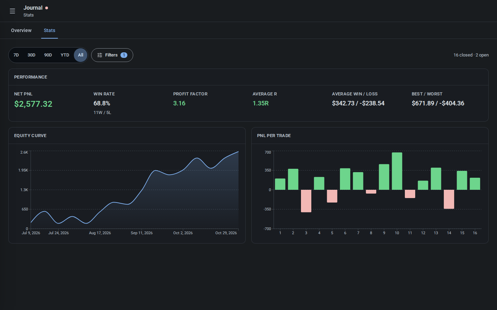
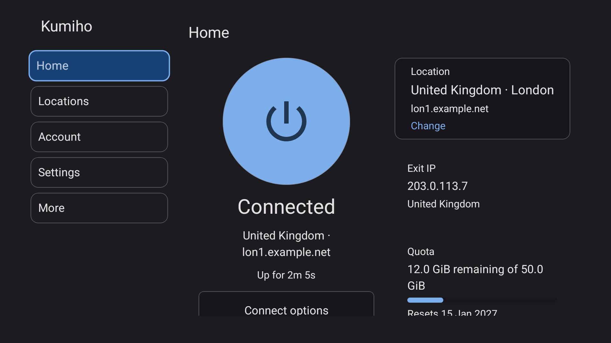

# benyamin

**just another vibe coder**

[benyaminprotonmail@proton.me](mailto:benyaminprotonmail@proton.me)

---

### I’m currently working on

<table>
  <tr>
    <td width="50%" valign="top" align="center">
       
      <strong><a href="https://github.com/benyamin-git/ClyTrade">ClyTrade</a></strong> 
      Local-first trade journal, spot portfolio tracker, price alerts and calculators. 
      
    </td>
    <td width="50%" valign="top" align="center">
       
      <strong><a href="https://github.com/benyamin-git/Kumiho">Kumiho</a></strong> 
      Unofficial client for the free Firefox Account VPN proxy on Linux, Windows, Android and Android TV. 
      
    </td>
  </tr>
  <tr>
    <td colspan="2" valign="top">
      <strong><a href="https://drbmshoes.com">Dr. BM Shoes Official Website</a></strong> 
      Persian storefront for a medical footwear shop; catalog-only orders through Bale or WhatsApp. 
      Not open source · <a href="https://t.me/drbmshoes">Telegram catalogue</a>
    </td>
  </tr>
</table>

<strong>More about these projects</strong>

- [Dr. BM Shoes Official Website](https://drbmshoes.com): static Persian storefront for a medical footwear shop, catalog-only, orders through Bale or WhatsApp (not open source and not owned by me), plus a Telegram catalogue bot and public catalogue at [@drbmshoes](https://t.me/drbmshoes).
- [ClyTrade](https://github.com/benyamin-git/ClyTrade): a local-first trading app with a trade journal, spot portfolio tracker, price alerts and calculators, plus an installable PWA with Windows and Android builds. These tools don't need server-side services and shouldn't be behind subscription plans, but are, so I have to vibe code them. [GitHub Page Sample](https://benyamin-git.github.io/ClyTrade)
- [Kumiho](https://github.com/benyamin-git/Kumiho): unofficial Linux, Windows, Android and Android TV client for the free Firefox Account VPN proxy, with a daemon, TUI/CLI/GUI, TUN/Wintun, a kill switch and systemd/Windows service support, similar to and inspired by [FoxyVPN](https://github.com/Vauth/FoxyVPN).

### Active side projects

<table>
  <tr>
    <td width="50%" valign="top">
      <strong><a href="https://github.com/benyamin-git/poker.pot">poker.pot</a></strong> 
      Phone-first poker pot manager with Android APK and PWA support. 
      
    </td>
    <td width="50%" valign="top">
      <strong><a href="https://github.com/benyamin-git/ORBYN">ORBYN</a></strong> 
      Terminal screensaver with orb, carrion and ASCII worm modes. 
      
    </td>
  </tr>
  <tr>
    <td width="50%" valign="top">
      <strong><a href="https://github.com/benyamin-git/dailypoker.bot">dailypoker.bot</a></strong> 
      Telegram bot for a house-rules poker game with friends. Not real money. 
      Single Bun process · SQLite · long polling
    </td>
    <td width="50%" valign="top">
      <strong><a href="https://github.com/benyamin-git/Inlign">Inlign</a></strong> 
      Local-first notepad that evaluates one equation per card with a Rust/WASM engine. Installable PWA. 
      No tagged release yet
    </td>
  </tr>
  <tr>
    <td colspan="2" valign="top">
      <strong><a href="https://github.com/benyamin-git/Anqa">Anqa</a></strong> 
      Self-hosted dashboard that runs Telegram bots as one Docker container per bot. 
      No tagged release yet · <a href="https://github.com/benyamin-git/Anqa/pkgs/container/anqa">GHCR image</a>
    </td>
  </tr>
</table>

<strong>More about side projects</strong>

- [dailypoker.bot](https://github.com/benyamin-git/dailypoker.bot): opinionated version of poker I play with friends, as a Telegram bot running as a single Bun process with a local SQLite database over long polling. Not normal betting rules and not real money.
- [Anqa](https://github.com/benyamin-git/Anqa): self-hosted dashboard for running Telegram bots as one Docker container per bot, with start, stop and autostart from one page. Early software; no tagged release yet.
- [poker.pot](https://github.com/benyamin-git/poker.pot): opinionated poker pot manager as a phone-viewport web app with Android APK and home-screen PWA support, to keep track of my friend group's poker bets and substitute a lack of chips. Not normal betting rules. [GitHub Page Sample](https://benyamin-git.github.io/poker.pot)
- [ORBYN](https://github.com/benyamin-git/ORBYN): simple terminal screensaver with an orb, a carrion creature and an ASCII worm to prevent burn-in.
- [Inlign](https://github.com/benyamin-git/Inlign): local-first notepad with one equation per card and a Rust/WASM engine that computes and cross-checks values as you type. The card notepad, variable engine and installable PWA work; no tagged release yet. The previous implementation is archived as [Inlign-legacy](https://github.com/benyamin-git/Inlign-legacy).

### Latest releases
<!-- releases:start -->
| Project | Latest release | Published |
| --- | --- | --- |
| [ClyTrade](https://github.com/benyamin-git/ClyTrade) |  | 2026-11-27 |
| [Kumiho](https://github.com/benyamin-git/Kumiho) |  | 2026-11-28 |
| [poker.pot](https://github.com/benyamin-git/poker.pot) |  | 2026-11-19 |
| [ORBYN](https://github.com/benyamin-git/ORBYN) |  | 2026-10-14 |
<!-- releases:end -->

<strong>Unmaintained / no longer active projects</strong>

- [poker.cli](https://github.com/benyamin-git/poker.cli): a CLI version of [poker.pot](https://github.com/benyamin-git/poker.pot) with known bugs and half-finished features. Archived on GitHub.
- [Coffer](https://github.com/benyamin-git/Coffer): text-only note-taking CLI with an encrypted single-file vault. Archived on GitHub.
- [Inlign-legacy](https://github.com/benyamin-git/Inlign-legacy): previous Inlign implementation. Archived on GitHub.

